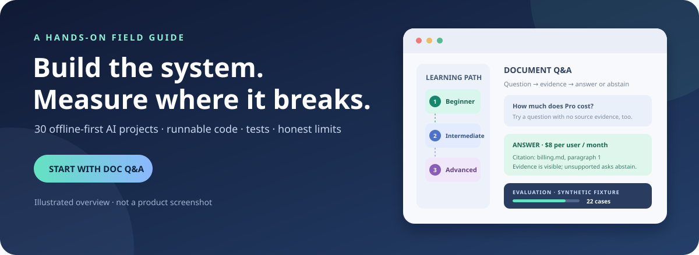

# Practical AI Systems

<p align="center">
  <strong>Build small AI systems. Test what they get wrong.</strong><br />
  30 offline-first projects with runnable code, tests, synthetic evaluations, and candid limitations.
</p>

<p align="center">
  <a href="https://github.com/shivamnegi92/practical-ai-systems/actions/workflows/catalog.yml"></a>
  <a href="LICENSE"></a>
  <a href="systems/"></a>
  <a href="https://shivamnegi92.github.io/practical-ai-systems/"></a>
</p>

<p align="center">
  <a href="https://shivamnegi92.github.io/practical-ai-systems/"></a>
</p>

> **Scope:** this is a learning lab, not a production toolkit or leaderboard. Systems use small synthetic fixtures to make behavior inspectable; scores are not evidence of real-world performance.

## Start here

**Choose by goal**

- **First AI project:** [Document Q&A](systems/doc_qa/README.md) — retrieve evidence, cite answers, and abstain when evidence is missing.
- **Practical Python:** [Invoice extraction](systems/invoice_extract/README.md) — extract fields and validate totals.
- **Team evaluation:** [Voice-agent evaluation](systems/voice_eval/README.md) — measure task success, unsafe actions, and latency separately.

## Run a system in 60 seconds

Requirements: Python 3.10+ and a terminal. The baseline uses no API key, model download, or third-party Python package.

```bash
git clone https://github.com/shivamnegi92/practical-ai-systems.git
cd practical-ai-systems
python3 -m systems.doc_qa.app "How much does Pro cost?"
```

You should get an answer with a source citation. Try asking about something absent from the sample documents—the system should abstain. Each system README includes its own commands, evaluation, tests, and limitations.

```bash
python3 -m systems.doc_qa.evaluate
python3 -m unittest systems.doc_qa.test_doc_qa -v
```

Prefer clicking over terminals? [Explore all 30 browser demos in the live gallery](https://shivamnegi92.github.io/practical-ai-systems/). Each system also has a zero-dependency web app; run one locally with `make serve SYSTEM=doc_qa` (Node 20+).

## What you can learn here

- **Build a baseline:** lexical retrieval, extraction, routing, caching, and document handling.
- **Evaluate behavior:** add synthetic cases, measure task-specific outcomes, and inspect failures.
- **Design guardrails:** constrain tools, require approval for side effects, and test adversarial inputs.
- **Operate systems:** track cost and latency, simulate rollouts, and inspect traces.

## Featured systems

<table>
  <tr>
    <td width="33%" align="center">
      <a href="systems/doc_qa/README.md"></a>
      <strong><a href="systems/doc_qa/README.md">Document Q&amp;A</a></strong><br>
      <sub>Grounded answers, citations, and abstention.</sub>
    </td>
    <td width="33%" align="center">
      <a href="systems/voice_eval/README.md"></a>
      <strong><a href="systems/voice_eval/README.md">Voice-agent evaluation</a></strong><br>
      <sub>Task success is not the same as safety.</sub>
    </td>
    <td width="33%" align="center">
      <a href="systems/bounded_agent/README.md"></a>
      <strong><a href="systems/bounded_agent/README.md">Bounded tool workflow</a></strong><br>
      <sub>Allow-list, approval gate, then action.</sub>
    </td>
  </tr>
</table>

## Browse the 30 runnable systems

The index is generated from each system's `system.json` manifest. Pick a level, open its guide, then run its test and evaluator. Each result links to the synthetic cases and reports the fixture size; it is a teaching aid, not a benchmark.

<!-- SYSTEMS:START -->

Browse all 30 projects by increasing scope. You can skip ahead if you already know the basics.

- **[Beginner](#beginner)** — no model setup; build core concepts.
- **[Intermediate](#intermediate)** — combine components and measure trade-offs.
- **[Advanced](#advanced)** — work through system boundaries and operations.

#### Beginner

Start here if this is your first AI project. No model account or paid API key is needed.

| System | What it demonstrates | Useful background | Evaluation |
|:--|:--|:--|--:|
| [Document Q&A with citations](systems/doc_qa/README.md) | Find a source paragraph, answer from its evidence, cite it, or abstain. | Terminal basics; Python is optional to run it. | [22 cases](systems/doc_qa/eval/results.json) |
| [Invoice field extraction](systems/invoice_extract/README.md) | Extract invoice fields, then validate dates and arithmetic. | Basic Python and key/value data. | [4 cases](systems/invoice_extract/eval/results.json) |
| [Repository hygiene checks](systems/repo_guard/README.md) | Run simple local checks and see why toy patterns miss real risks. | Basic file and folder navigation. | [4 cases](systems/repo_guard/eval/results.json) |
| [Extractive text summarizer](systems/text_summarizer/README.md) | Pick the most representative sentences from a short document using word-frequency scoring. | Terminal basics; Python is optional to run it. | [5 cases](systems/text_summarizer/eval/results.json) |
| [Near-duplicate question detector](systems/dedupe_questions/README.md) | Flag probable duplicate support questions with token Jaccard similarity. | Basic Python and string comparison. | [5 cases](systems/dedupe_questions/eval/results.json) |
| [PII pattern redactor](systems/pii_redactor/README.md) | Find and mask obvious email, phone, SSN, and credit-card-shaped strings in free text. | Basic Python and regular expressions. | [5 cases](systems/pii_redactor/eval/results.json) |
| [Lexicon-based sentiment classifier](systems/sentiment_lexicon/README.md) | Classify short text as positive, negative, or neutral using a small hand-built word list. | Basic Python and word lists. | [5 cases](systems/sentiment_lexicon/eval/results.json) |
| [Readability grade scorer](systems/readability_scorer/README.md) | Estimate a Flesch-Kincaid-style reading grade level and bucket it into simple/standard/complex. | Basic Python; no linguistics background needed. | [4 cases](systems/readability_scorer/eval/results.json) |
| [FAQ intent router](systems/faq_router/README.md) | Route a short support message to one of five fixed intents using keyword overlap. | Basic Python and keyword matching. | [6 cases](systems/faq_router/eval/results.json) |
| [CSV/record schema validator](systems/csv_schema_validator/README.md) | Catch missing required fields and type mismatches in structured records before they reach an AI pipeline. | Basic Python and JSON/dictionary data. | [5 cases](systems/csv_schema_validator/eval/results.json) |

#### Intermediate

For people comfortable with basic Python who want to work with data and evaluation metrics.

| System | What it demonstrates | Useful background | Evaluation |
|:--|:--|:--|--:|
| [Post-OCR document extraction](systems/multimodal_ocr/README.md) | Normalize OCR line order from bounding boxes, then extract fields. OCR itself is not run. | Basic Python and JSON/list/dictionary data. | [3 cases](systems/multimodal_ocr/eval/results.json) |
| [Entity spans and error analysis](systems/entity_extraction/README.md) | Extract person/date/money spans and inspect exact-match precision, recall, and F1. | Python functions, regular expressions, and basic metrics. | [4 cases](systems/entity_extraction/eval/results.json) |
| [Exact-response cache](systems/semantic_cache/README.md) | Explore normalized keys, TTL expiry, LRU eviction, and model/version isolation. | Python classes, dictionaries, and basic cache concepts. | [4 cases](systems/semantic_cache/eval/results.json) |
| [Synonym query rewriter](systems/query_rewriter/README.md) | Expand a query with a small synonym list before BM25 retrieval, and measure the recall it recovers. | Python functions and basic lexical retrieval. | [4 cases](systems/query_rewriter/eval/results.json) |
| [Prompt-injection pattern scanner](systems/prompt_injection_detector/README.md) | Scan untrusted text for common prompt-injection phrasing before it reaches a model. | Regular expressions and basic LLM-safety concepts. | [6 cases](systems/prompt_injection_detector/eval/results.json) |
| [Cost and latency guardrail tracker](systems/cost_latency_tracker/README.md) | Summarize a request log into p50/p95 latency and cost, then flag budget breaches. | Basic statistics (percentiles) and Python. | [3 cases](systems/cost_latency_tracker/eval/results.json) |
| [Post-OCR table reconstruction](systems/table_extractor/README.md) | Cluster OCR line bounding boxes into rows and columns to rebuild a simple table grid. | Basic Python and coordinate geometry intuition. | [2 cases](systems/table_extractor/eval/results.json) |
| [Image caption QC](systems/caption_qc/README.md) | Run rule-based checks on autogenerated image captions: placeholders, length, and required keywords. | Basic Python and string checks. | [5 cases](systems/caption_qc/eval/results.json) |
| [RAG citation support checker](systems/citation_checker/README.md) | Verify that inline citations in a generated answer are lexically supported by the cited chunk. | Basic Python and lexical overlap concepts. | [4 cases](systems/citation_checker/eval/results.json) |
| [Schema drift detector](systems/schema_drift_detector/README.md) | Diff a batch of records against a declared schema: new fields, missing fields, and type mismatches. | Python dictionaries and basic data typing. | [2 cases](systems/schema_drift_detector/eval/results.json) |

#### Advanced

For builders ready to reason about agent boundaries, protocols, and evaluation quality.

| System | What it demonstrates | Useful background | Evaluation |
|:--|:--|:--|--:|
| [Voice-agent transcript evaluator](systems/voice_eval/README.md) | Score call success, forbidden actions, and latency separately. | Structured transcripts and evaluation rubrics. | [3 cases](systems/voice_eval/eval/results.json) |
| [Judge agreement audit](systems/judge_audit/README.md) | Compare a heuristic with human ratings and inspect rater disagreement. | Classification metrics and labeled data. | [6 cases](systems/judge_audit/eval/results.json) |
| [Approval-gated tool workflow](systems/bounded_agent/README.md) | Constrain tools with an allow-list and require approval before sensitive actions. | Python functions, tools/APIs, and authorization concepts. | [3 cases](systems/bounded_agent/eval/results.json) |
| [Local knowledge-base MCP server](systems/mcp_kb/README.md) | Expose local search and source reads as JSON-RPC-style tools. | Python, JSON-RPC, and client/server concepts. | [4 cases](systems/mcp_kb/eval/results.json) |
| [Multi-agent triage handoff](systems/multi_agent_handoff/README.md) | Route a request through a triage step to the right specialist, escalating when confidence is low. | Agent orchestration and escalation design. | [4 cases](systems/multi_agent_handoff/eval/results.json) |
| [Retrieval evaluation harness](systems/retrieval_eval_harness/README.md) | Score retrieval with recall@k, MRR, and nDCG@k, and compare two strategies side by side. | IR evaluation metrics (recall, MRR, nDCG). | [4 cases](systems/retrieval_eval_harness/eval/results.json) |
| [Canary rollout simulator](systems/canary_rollout_simulator/README.md) | Compare canary metrics against a baseline to decide promote or rollback. | Deployment guardrails and basic statistics caveats. | [3 cases](systems/canary_rollout_simulator/eval/results.json) |
| [Adversarial red-team harness](systems/redteam_harness/README.md) | Run adversarial requests against a bounded agent's policy and measure the breach rate. | Agent authorization boundaries and adversarial thinking. | [5 cases](systems/redteam_harness/eval/results.json) |
| [Trace anomaly detector](systems/trace_anomaly_detector/README.md) | Flag anomalous execution-trace durations with a z-score against a historical baseline. | Basic statistics (mean, standard deviation, z-scores). | [4 cases](systems/trace_anomaly_detector/eval/results.json) |
| [Multi-hop reasoning router](systems/multi_hop_router/README.md) | Split a multi-part question into sub-questions and abstain unless every part is answered. | Retrieval-augmented QA and question decomposition. | [3 cases](systems/multi_hop_router/eval/results.json) |
<!-- SYSTEMS:END -->

The project index is grouped by experience level; the next sections are optional deep dives.

<!-- PATHS:START -->

Browse curated workflows generated from the same catalog records—no project is duplicated across path docs.

- [Build a document-search baseline](catalog/paths.md#build-a-document-search-baseline)
- [Evaluate an AI feature before scaling it](catalog/paths.md#evaluate-an-ai-feature-before-scaling-it)
- [Operate a bounded tool-using agent](catalog/paths.md#operate-a-bounded-tool-using-agent)
<!-- PATHS:END -->

## Explore the curated toolbox

<!-- CATALOG:START -->

| Need | Browse |
|:--|:--|
| Build workflows that use tools, state, and human decisions. | [Agents and orchestration](catalog/agents.md) |
| Connect applications to search, documents, and indexed knowledge. | [Retrieval and knowledge systems](catalog/retrieval.md) |
| Turn text and documents into structured, usable data. | [Information extraction and document AI](catalog/extraction.md) |
| Build applications that handle images, audio, video, and interactive media. | [Multimodal application tools](catalog/multimodal.md) |
| Measure quality and inspect system behavior before and after release. | [Evaluation and observability](catalog/evaluation.md) |
| Package, serve, scale, and operate AI workloads. | [Deployment and operations](catalog/operations.md) |

20 curated projects across 6 areas; every entry links to its canonical source and includes its review status.
<!-- CATALOG:END -->

## How to use this collection

**For learners:** start with the README quickstart, then run its tests and evaluation. Change one synthetic case and observe what breaks.

**For instructors:** use a system as a lab—have learners reproduce the baseline, add an edge case, and explain the result and limitation.

**For professional teams:** treat these as design patterns, not production services. Review privacy, authorization, dependencies, and evaluation gaps before adapting them to real workflows.


## Contribute

Contributions of every size are welcome—from a typo fix to a complete new system.
You do not need permission to propose an idea or open a pull request. **Nothing
merges without maintainer approval:** a pull request is a proposal, not a promise
of acceptance, and the maintainer reviews and approves every contributor PR.
This keeps the project open to ideas while the quality bar stays deliberate.

```bash
make check                                   # run everything CI runs
make new SYSTEM=my_system                    # scaffold a new system with Python, web app, tests, and npm lockfile
make test SYSTEM=doc_qa                      # test one system
make eval SYSTEM=doc_qa                      # regenerate its eval/results.json
make serve SYSTEM=doc_qa                     # open its web app at http://localhost:4173
```

- **5 minutes:** fix a README or [report a failing case](https://github.com/shivamnegi92/practical-ai-systems/issues/new?template=failing-case.yml).
- **30 minutes:** add eval cases that break a system, or improve a web app.
- **A few hours:** propose a new system with [`docs/ADDING_A_SYSTEM.md`](docs/ADDING_A_SYSTEM.md). Scope requests are welcome before implementation.

Read [CONTRIBUTING.md](CONTRIBUTING.md) and the [Code of Conduct](CODE_OF_CONDUCT.md). Find [good first issues](https://github.com/shivamnegi92/practical-ai-systems/labels/good%20first%20issue) or [help-wanted tasks](https://github.com/shivamnegi92/practical-ai-systems/labels/help%20wanted). You may open a PR directly; opening or claiming an issue first is encouraged to avoid duplicate effort, not required for small changes. The maintainer makes the final merge decision.

## Related resources

- [Learning paths](catalog/paths.md) — guided sequences through tools and projects.
- [Curated toolbox](catalog/README.md) — reviewed external projects by capability.
- [Recipes](recipes/) — original field guides for common workflows.
- [Evaluation playbook](benchmarks/README.md) — design representative tests and interpret results.
- [Changelog](CHANGELOG.md) — recent project updates.

## License

Original material is released under [CC0 1.0](LICENSE). Linked projects retain their own licenses and terms.
